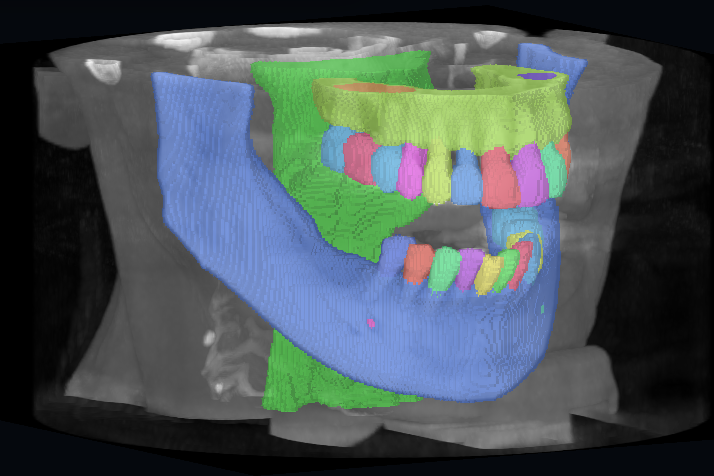

# ToothFairy NIfTI Viewer

A VS Code extension for interactive viewing of CBCT NIfTI volumes and their segmentation masks. It opens `.nii` and `.nii.gz` files as a custom editor with a GPU-rendered 3D view and an optional four-up (axial, coronal, sagittal + 3D) layout.



## Install

Search for **ToothFairy NIfTI Viewer** in the Extensions view, or run `code --install-extension morelli01.toothfairy-nifti-viewer`. Then open any `.nii` or `.nii.gz` file.

## How it works

### Opening a file

`.nii` and `.nii.gz` files open in the viewer by default. You can also use **Open with ToothFairy NIfTI Viewer** from the Command Palette, or **Reopen Editor With…** on a file already open elsewhere. The viewer is read-only: it never modifies the file.

When a file opens, the viewer:

1. Reads the file locally and decompresses `.nii.gz` in the webview.
2. Parses the NIfTI-1 or NIfTI-2 header and reads the voxels: 8/16/32-bit integers (signed or unsigned) or 32/64-bit floats, little- or big-endian. Intensity scaling (`scl_slope`, `scl_inter`) is applied. For 4D+ files only the first 3D frame is shown.
3. Takes voxel spacing and axis directions from the header transform (see [Orientation](#orientation)).
4. Picks a display mode. A file whose values are a small set of integers (0–255, at most 160 distinct values) is treated as a label map and opens in **Mask only** mode. Anything else opens as a CBCT with a percentile-based level/window.

The metadata line under the file name summarizes what was read: dimensions, spacing and unit, data type, transform source and orientation code (e.g. `sform LPS`), the origin's world position, and the GPU texture size.

### What is displayed

**3D view.** The volume is ray-marched on the GPU with one of three styles:

- **MIP**: maximum-intensity projection, useful for dense structures.
- **Attenuated MIP**: depth-aware maximum-intensity rendering, matching the LMArena Dental viewer.
- **Isosurface**: a ray-marched surface at the selected threshold.

For responsiveness, the 3D texture is a box-filtered 8-bit copy capped at 256 voxels per axis. Level/window, render style and threshold apply instantly. Left-drag orbits turntable-style around the vertical axis (superior in anatomical orientations, +k in raw mode), so circular drags never accumulate roll. Right-drag pans, the wheel zooms, **Axial** looks up from the feet, and **Reset 3D** restores the starting view.

**Four-up.** This switches to axial, coronal and sagittal slices plus the 3D view. Slices are sampled from the full-resolution data (nearest-neighbour, at most 768 px per side) in radiological convention: patient right on screen left, anterior and superior up, sagittal with anterior on the left. Edges are labelled R/L, A/P, S/I (±i/±j/±k in raw mode).

- Click or drag to move the crosshair; scroll to step one voxel through a slice.
- The panel title shows the slice position in mm, measured from the volume centre (the display is centred on the volume, not on scanner coordinates).
- Level/window and the mask overlay are shared with the 3D view, and slices always use the same orientation as the 3D view.

### Orientation

Nothing is changed automatically: the **Orientation** menu decides how the voxel axes i, j, k are placed in patient space. It always starts on **Header**.

- **Header (code)**, the default, uses the file's own transform. The sform is used if `sform_code > 0`, else the qform, else the pixdim spacing alone. The menu shows the resulting code, e.g. `Header (LPS)`. Oblique transforms are honoured, and slices are resampled axis-aligned in patient space.
- **Raw voxels** shows the stored grid exactly as it is in memory: i, j and k are drawn along the display x, y and z, with physical spacing. Slice edges are labelled ±i/±j/±k instead of anatomical directions, because the header is not used.
- **Standard codes** assign any of the 48 axis-aligned orientations to i·j·k. The menu offers the 8 common ones (RAS, LAS, RPS, LPS, RAI, LAI, RPI, LPI) plus the 40 with permuted axes (e.g. ASL). A code names the direction in which each voxel axis increases: `LPI` means i → left, j → posterior, k → inferior. Spacing still comes from the header; only the directions are replaced. Use this when a header is wrong.

**ToothFairy3:** headers say LPS, but the FDI tooth positions put the voxel axes at RPI. This holds for 385 of the 386 masks with enough teeth to tell, so choose **RPI** for ToothFairy3. LPI, a superior/inferior flip alone, would mirror left and right.

A loaded overlay mask always follows the CBCT's orientation. The 3D view is never mirrored.

### Image origin

The image origin is the centre of voxel (0, 0, 0), the first stored voxel. It is marked in every orientation mode:

- **3D view:** three arrows start at the origin and point toward increasing **i** (red), **j** (green) and **k** (blue), each labelled with its letter. They turn with the chosen orientation, so they show exactly where each voxel axis goes. For example, with RPI the k arrow points down (inferior). They are drawn on top, so the volume never hides them.
- **Slices:** a white ring marks where the origin falls in each panel. It is usually a corner of the image, and is kept on screen when it sits on the panel edge.
- **Metadata line:** `origin (x, y, z) mm` gives the origin's world position from the header transform's translation. For ToothFairy3 this is `(0, 0, 0)`.

## Segmentation masks

The **Display** control switches between **CBCT**, **Mask only**, and **CBCT + mask**. A label map opened directly starts in **Mask only**. From a CBCT, choose **Load mask…** to pick an aligned `.nii` or `.nii.gz` label map (inside the workspace or beside the open volume); the viewer then enters overlay mode. Overlay masks must have the same dimensions, spacing and spatial transform as the open CBCT. Mismatches are rejected rather than silently misregistered. Mask opacity is adjustable in both mask modes.

Labels 1–255 receive deterministic, high-contrast categorical colours. In 3D, masks are downsampled by keeping the most frequent non-background class in each block (label IDs are never averaged) and sampled nearest-neighbour; slices sample the full-resolution labels.

The **Labels** panel is a full-height, collapsible sidebar. It lists every class present at full resolution, with its colour, number and name.

- **Names** come from the nearest nnU-Net or MSD `dataset.json`, looked up in the file's folder and up to three folders above. Without one, the built-in ToothFairy2/3 names are used: jaws, canals, sinuses, pharynx, FDI teeth 11–48 and pulps 111–148.
- **Toggling:** click a row to hide or show that class, or click **Only** to show just that class.
- **Filtering:** type in the filter (`pulp`, `lower left`, `36`) to narrow the list. **Show all**, **Hide all** and **Invert** act on the listed rows only, so filtering `pulp` and then clicking **Hide all** hides every pulp.

Hidden classes neither draw nor occlude visible classes behind them. Visibility resets when a new mask is loaded.

## Run locally

```bash
git clone https://github.com/Morelli-01/toothfairy-nifti-viewer
cd toothfairy-nifti-viewer
npm install
npm run build
code .
```

Press **F5** in VS Code to launch an Extension Development Host, then open a `.nii` or `.nii.gz` file. Run `npm test` for the geometry, orientation, scaling, label and slice regression checks.

## Build and install a VSIX

```bash
npm install
npm run package
code --install-extension toothfairy-nifti-viewer-*.vsix --force
```

Volume data never leaves your machine: files are read locally and rendered in the VS Code webview with WebGL.
